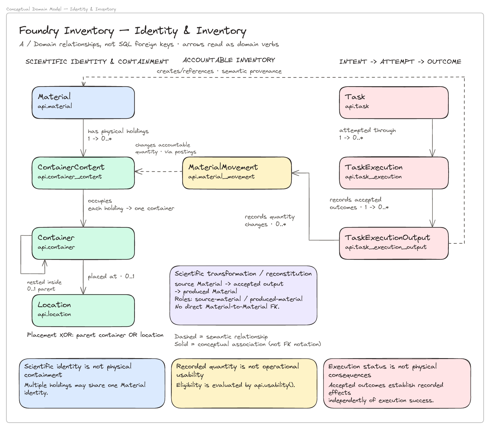

# Foundry Inventory

**A Traceable Material & Inventory System for Automated Laboratories**

Engineering design submission for Adaptyv Bio.

## Overview

Foundry Inventory is a PostgreSQL-backed design and implementation for tracking scientific materials in a high-throughput protein characterization laboratory.

The central challenge is not simply knowing how much material exists. It is maintaining a trustworthy account of **what exists, where it is, whether it can be used, how it got there, and what happened when an operation failed or was corrected**.

The system separates scientific identity, physical containment, inventory accounting, and operational execution. It uses immutable records and transactional operations to preserve traceability and enforce correctness under retries, partial execution, and historical correction.

## Architecture

The implemented model separates scientific `Material` identity from physical `Container`s and accountable holdings. Intended `Task`s, execution attempts and accepted consequences have separate identities. Quantity accounting is distinct from operational eligibility: a recorded balance does not by itself mean material can be used.

[](docs/diagrams/01-identity-inventory.png)

Explore the [complete diagram index](docs/diagrams/README.md) and [engineering design rationale](docs/motivation.md).

### Design Artifacts

The architecture is documented at three complementary levels:

- **[Formal specifications](docs/whitepapers/):** Define the domain semantics, state transitions, and invariants.
- **[Architecture Decision Records](docs/decisions/):** Explain architectural choices, alternatives, and trade-offs.
- **Implementation and tests:** Demonstrate which guarantees are enforced by the delivered PostgreSQL system.

## Implementation and Validation

The implementation uses PostgreSQL, with transactional handlers responsible for validating and committing inventory operations.

It includes:

- Versioned specifications and governed operational contracts.
- Material, container, location, and holding identities.
- Inventory registration and receipt operations.
- Balanced quantity movements and transfer accounting.
- Execution records, accepted outputs, and effect commitment.
- Selected provenance, eligibility, correction, and reconciliation mechanisms.
- Transactional guards, concurrency protection, and idempotency.
- Tests covering normal operations, invalid transitions, duplicate requests, failure handling, and recovery.

The implementation is organized as ordered SQL migrations, supported by development fixtures, integration tests, and a containerized environment.

### Running Locally

With Docker Compose and Python 3 installed, run from the repository root:

```bash
cd src && ./scripts/test.sh
```

The test script starts the PostgreSQL and API services, initializes the database, creates a virtual environment, installs test dependencies, and runs the integration tests.

**Warning:** Both `scripts/test.sh` and `scripts/reset.sh` recreate the demonstration database, destroying its existing data. To initialize the environment without running tests, run `./scripts/reset.sh` from `src/`.

Refer to the scripts and Compose configuration for environment variables, port overrides, and database initialization behavior.

## Scope and Limitations

The whitepapers and ADRs describe a broader operational model than the bounded implementation delivered for this assignment.

The implementation focuses on trustworthy inventory accounting and traceable laboratory operations rather than attempting to build a complete LIMS or workflow orchestration platform.

The principal boundaries are:

- **Quality:** QC-gated eligibility and scientific invalidation are supported. Initial QC approvals are seeded rather than established through a complete public QC workflow.
- **Material production:** Single-source reconstitution and provenance are supported. Generalized multi-source composition and incremental preparation are outside the implemented slice.
- **Specification evolution:** Immutable published versions and explicit bindings are supported; existing entities cannot currently be rebound.
- **Corrections:** Selected movement replacement and physical reconciliation are supported. Generalized reversal and correction of incorrectly identified containers are not implemented.
- **Expiration:** Explicit holding-level expiration cutoffs are supported. Environmental exposure evaluation and public cutoff assignment are deferred.
- **Concurrency:** The implementation deliberately favors a simple shared advisory-lock boundary over fine-grained concurrent execution.

These are implementation boundaries, not claims that the corresponding domain problems are unimportant.

Experiment planning, procurement, reservations, and scheduling are also outside the assignment's inventory authority.

## Development Methodology

This work began before receiving the assignment. Following my initial 1:1 conversation with Theo, I became interested in understanding how Adaptyv's laboratory operations could be represented as a software system.

I independently researched the business, explored wet-lab practices and existing solutions, and began developing a preliminary domain model and its underlying algebra.

The assignment subsequently provided concrete inventory requirements and a binding workflow against which I could validate, challenge, and refine that initial model.

### Phase 1 — Independent Exploration (Before the Assignment)

1. **Business research:** Investigated Adaptyv's business model, commercial context, and operational direction.
2. **Operational research:** Studied parSEQ and publicly available wet-lab practices.
3. **Adjacent solutions:** Explored Benchling and comparable systems to understand scientific identities and relationships.
4. **System invariants:** Identified preliminary correctness requirements around inventory, identity, provenance, and failure recovery.
5. **Algebraic formalization:** Began modeling entities, relationships, and state-transforming operations.

### Phase 2 — Assignment-Driven Design

6. **Binding workflow analysis:** Evaluated the supplied workflow against the preliminary model.
7. **Architecture Decision Records:** Documented architectural alternatives, decisions, and trade-offs.
8. **Scenario validation:** Challenged the model with partial execution, reruns, corrections, and scientific reassessment.
9. **Parallel modeling and LLM context ablation:**
   - Compared one-shot LLM-generated models using four contexts: brief only, brief + parSEQ, brief + Benchling, and brief + both.
   - Developed independent relational models and evaluated them against the same invariants.
10. **Implementation:** Translated the selected model into PostgreSQL structures, governed operations, and invariant tests.
11. **Final review:** Reconciled requirements, decisions, implementation, and documented limitations.

**Guiding principle:** Model the domain and its state transformations first; choose the database representation afterward. The schema should express the operational ontology and preserve its invariants, not define them by accident.

For the detailed reasoning behind the architecture, see [Engineering Approach & Design Rationale](docs/motivation.md).
