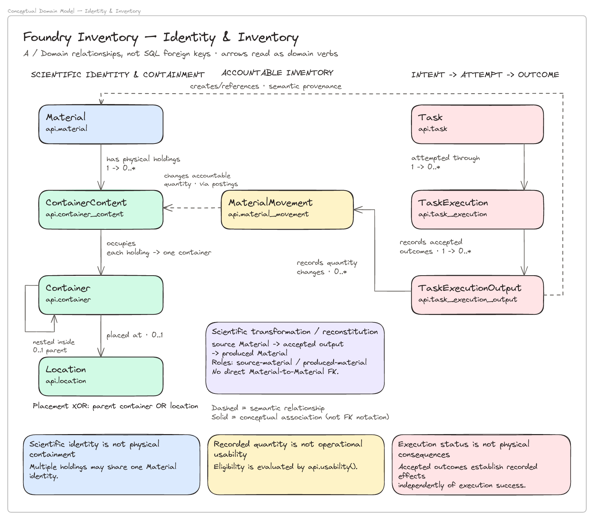
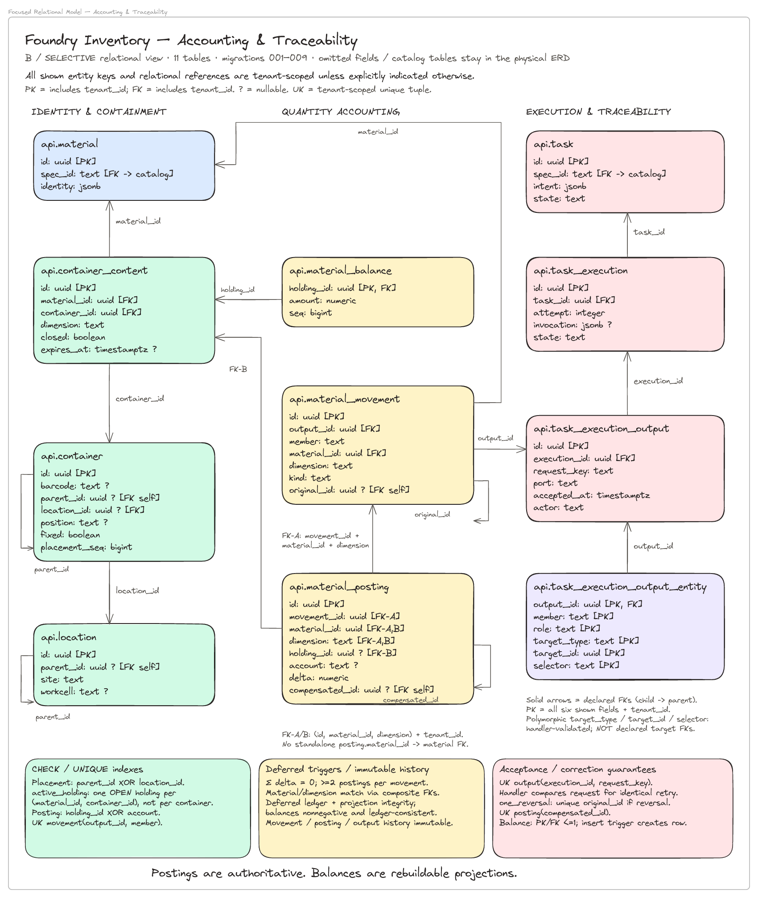
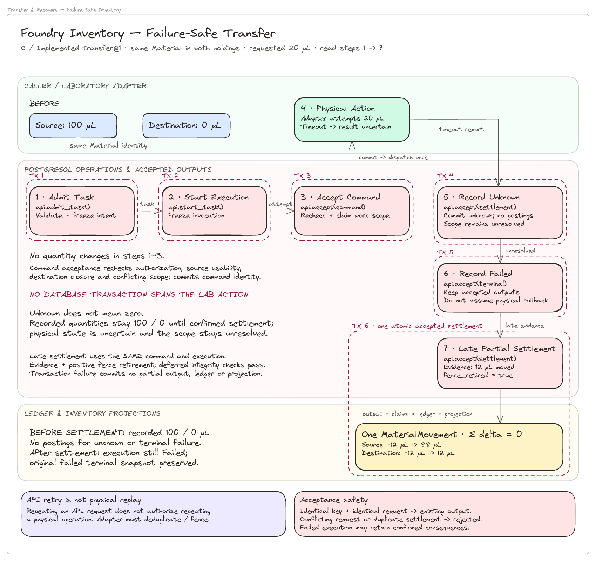

# Foundry Inventory — design diagrams

## Presentation order

1. **Identity & Inventory** — separate scientific identity, holdings, placement, and accepted consequences.
   [Editable Excalidraw](01-identity-inventory.excalidraw) · [PNG](01-identity-inventory.png)

   

2. **Accounting & Traceability** — the selective 11-table accounting and traceability spine.
   [Editable Excalidraw](02-accounting-traceability.excalidraw) · [PNG](02-accounting-traceability.png)

   

3. **Failure-Safe Transfer** — a requested 20 µL transfer times out; late evidence confirms 12 µL, leaving recorded quantities 88/12 and the execution Failed.
   [Editable Excalidraw](03-transfer-recovery.excalidraw) · [PNG](03-transfer-recovery.png)

   

4. **Physical Database Schema** — the complete 19-table / 35-FK reference in [the editable appendix](appendix/foundry-inventory.excalidraw).

The appendix document also contains the three focused views to the right of the original physical ERD and conceptual frame. Each standalone Excalidraw file contains one frame, with a PNG export linked above. For the engineering context behind these views, see [Engineering Approach & Design Rationale](../motivation.md).

## Read the notation

- **Conceptual view:** solid arrows are domain associations, not SQL FKs. Dashed arrows indicate semantic relationships implemented through postings or accepted-output provenance. The transformation example describes the implemented single-source reconstitution, not an invented Material-to-Material FK.
- **Relational view:** solid arrows point from referencing table to referenced table. PK/FK notation includes the undisplayed `tenant_id`; compound posting references explicitly include Material and dimension. The six displayed output-relationship fields jointly form its PK with `tenant_id`. `?` means nullable in SQL. Catalog references are marked on `spec_id`, but catalog tables and secondary references through omitted fields are intentionally excluded. Polymorphic targets are not declared target FKs.
- **Transfer view:** numbered steps show sequence; red dashed outlines mark **six separate database transactions**. The final transaction includes accepted settlement, relationships, ledger entries and balance projection updates. None spans the laboratory action. Settlement reuses the original command and execution and requires evidence plus positive fence retirement. “Dispatch once” is an adapter obligation, not a database guarantee of exactly-once physical action.

Postings are authoritative; balances are transactionally maintained, rebuildable projections. Recorded quantity is not an eligibility decision.

## Verification and implementation sources

- [001_schema.sql](../../src/migrations/001_schema.sql): table types, tenant-composite PKs/FKs, placement/posting XOR, active holding uniqueness, movement/member uniqueness, reversal and compensation uniqueness, balance initialization, immutable history.
- [002_handlers.sql](../../src/migrations/002_handlers.sql): deferred balanced-ledger enforcement, acceptance retry comparisons, unknown versus confirmed settlement, positive external fencing, terminal outcomes and late recovery.
- [003_integrity_and_rpc.sql](../../src/migrations/003_integrity_and_rpc.sql): deferred projection/output integrity and balance rebuilding.
- [004_physical_inventory.sql](../../src/migrations/004_physical_inventory.sql): physical scope and supported transformation provenance.
- [005_schema_consistency.sql](../../src/migrations/005_schema_consistency.sql) and [006_validation.sql](../../src/migrations/006_validation.sql): UUID/timestamp semantics and stricter validation.
- [007_initiation_workflows.sql](../../src/migrations/007_initiation_workflows.sql): keyed admission/start and frozen invocation (`invocation` remains SQL-nullable).
- [008_scoped_effects.sql](../../src/migrations/008_scoped_effects.sql): sealed accepted-output relationships and additional scoped enforcement, intentionally not expanded in these focused views.
- [009_transfer_authorization.sql](../../src/migrations/009_transfer_authorization.sql): command-time closed-destination recheck; **behavior change, no relational topology change**. The preserved physical ERD's original coverage caption still ends at 008.
- [test_modelj.py](../../src/tests/test_modelj.py), `test_C01_partial_zero_unknown_late_resolution_terminal_snapshot`: the 100/0 → unknown → Failed → late 12 µL → 88/12 example and preserved terminal snapshot.

Verification performed: individual frame rendering and visual inspection, 8 conceptual entities / 11 selected tables / 7 workflow steps, arrow-binding integrity, and exact equality of all 821 original combined-scene elements against the pre-existing repository version. No database reset or integration tests were run for this diagram-only change.
