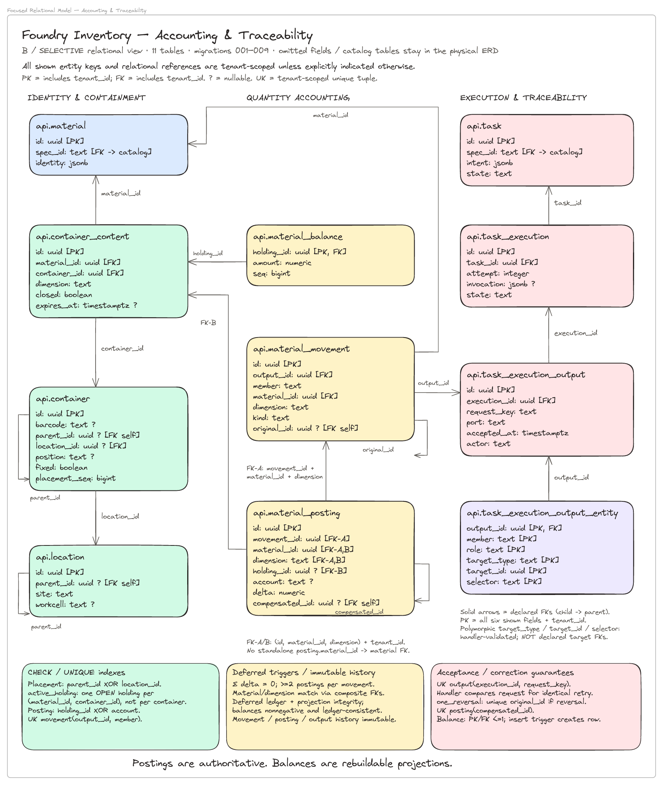
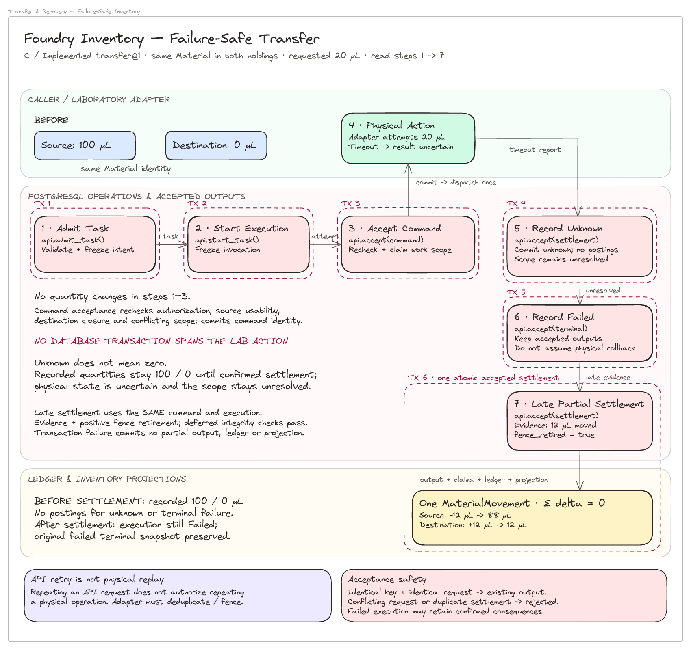

# Engineering Approach & Design Rationale

*Inventory management for a high-throughput protein characterization laboratory*

## 1. Experience that informed the design

I started exploring Adaptyv's laboratory operations after my initial conversation with Theo, before receiving the inventory assignment. My experience in logistics and semiconductor testing gave me a few starting questions about inventory correctness, execution failures, and historical corrections.

### Inventory correctness from logistics

My experience in warehousing, fulfillment and last-mile operations taught me to separate inventory movements from balances, handle duplicate operations and distinguish system records from physical reality.

This informed the immutable double-entry ledger: `MaterialMovement` and `MaterialPosting` are authoritative, while `MaterialBalance` is a transactionally maintained, rebuildable projection.

I also experienced the limitations of operational software firsthand. In one warehouse system, querying inventory by lot and expiration date became problematic, leading us to use a workaround involving sink accounts. That reinforced an important distinction: operations need flexibility, but accounting correctness should not be negotiable. New account types, governed adjustments and read projections should not require editing quantities or rewriting history.

### Fault-tolerant experiments from semiconductor testing

At a fabless semiconductor company, I worked with an internal laboratory used to test sub-lots. Instrument failures, repeated measurements, R&D outside established procedures and retrospective corrections were normal.

That experience taught me to preserve what was intended, attempted, observed and subsequently corrected. It directly informed the separation between `Task`, `TaskExecution`, `TaskExecutionOutput`, `Observation` and `Assessment`.

Instruments also produced large datasets that could be postprocessed in multiple ways. A failed analysis did not necessarily require repeating the measurement. Here, an Observation preserves accepted measurement evidence and its acquisition context; an Assessment records an interpretation under a versioned scientific contract. New interpretations need not duplicate raw data or overwrite earlier conclusions.

## 2. Adapting those lessons to wet-lab operations

I did not assume that logistics or manufacturing identity models would transfer directly to protein characterization. I read Adaptyv's parSEQ technical report and explored Benchling to better understand biological identity, preparations, samples and containers.

That research helped establish a foundational distinction: **a scientific Material, a physical Container and the inventory held within it are different identities.** Aliquoting a preparation into several wells need not create new scientific preparations; a meaningful transformation may create a new Material without changing containers.

The assignment's binding workflow provided concrete operations against which to test those distinctions.

## 3. A shared operational model

Despite their different physical and scientific consequences, these operations can be described through the same sequence:

**Declared inputs → intended work → actual execution → accepted outcomes → validated consequences.**

Versioned `TaskSpecification` records define permitted inputs, outputs, lifecycle conditions and effects. Tasks bind these contracts to resources; executions record attempts; immutable output manifests preserve accepted outcomes, including partial success and uncertainty.

Internally, workflows reuse this machinery as composite Tasks, while remaining first-class API concepts. This avoids a parallel persistence model at the cost of more involved workflow queries and validation. An external scheduler initiates execution attempts; this is a foundation for bounded workflows, not a general-purpose orchestration engine.

Task identity, API retry identity and semantic Effect identity are distinct. Identical Tasks may be legitimate experimental replicates, while accepting the same delivery twice is not. Specifications therefore declare the intended semantic uniqueness policy and scope; not every scope is implemented and tested.

## 4. PostgreSQL, governed JSONB and trade-offs

Having used relational and non-relational databases, I wanted to accommodate changing procedures without weakening inventory guarantees. **Relational structures protect stable identities and invariants; governed JSONB carries variable operational and scientific contracts.** Immutable specification versions define payload requirements, and trusted PostgreSQL handlers validate acceptance and consequences. Correctness-critical relationships remain relational.

During SQL reconciliation, I found that required JSONB values could bypass checks because PostgreSQL comparisons involving NULL return UNKNOWN. Acceptance handlers must positively establish preconditions: missing, null or malformed values cannot satisfy a contract.

I also chose UUIDv7. From previous experience, roughly time-ordered identifiers have been useful when debugging distributed workflows and correlating records across components. PostgreSQL 18's native support made that a straightforward choice.

The polymorphic Task model has a cost: receiving, plate transfers and scientific analysis share machinery despite different read/write patterns. That introduces validation overhead, polymorphic indexes, more complex queries and potentially write amplification. The initial shared advisory-lock strategy also favors correctness over concurrency. These are initial trade-offs, not permanent commitments: specialize transfer paths, indexes or projections when measured throughput and contention justify it.

## 5. Corrections without rewriting history

Corrections are governed operations, not database maintenance. New measurements and Assessments can revise scientific conclusions while preserving earlier evidence. Inventory corrections use attributable compensating or replacement postings.

This matters when execution status and physical reality diverge. A transfer requested for 20 µL may fail with an uncertain outcome; later evidence may confirm that 12 µL moved. The ledger records the confirmed quantity without rewriting the failed execution.

Failure does not imply physical rollback, and API idempotency does not make repeating a laboratory action safe. The database transactions surround the physical action rather than span it. Likewise, a revised Assessment may change a material's usability without changing its historical movements.

## 6. Workcell, site and tenant boundaries

My manufacturing experience made the **workcell** a useful grouping for Tasks, operators, instruments and accessible resources. Execution history could eventually support capacity and utilization analysis, but reliable optimization requires additional operational measurements.

The London laboratory expansion also informed explicit **site** identity. Customer-facing experimental intent should be separable from the facility performing it. Site identity preserves custody boundaries; it does not itself implement cross-site logistics or scheduling.

My experience building operational systems also suggested a possible **tenant** boundary: the software might eventually have value independently of the physical service. This is a product possibility, not a claim about Adaptyv's plans. Organizational ownership, physical custody and execution capacity are distinct concerns; full multi-tenant security and distributed operations require further implementation and verification.

## 7. Scope and objective

This is an inventory foundation, not a complete LIMS, ELN or orchestration platform. Dedicated models for every operation would duplicate common mechanisms; a generic rules engine would add complexity beyond the assignment. Versioned declarative specifications with explicit trusted handlers are the middle ground.

The ADRs explain why I made these choices. The SQL constraints, transactional handlers, and tests are where I tried to demonstrate that they actually hold.
